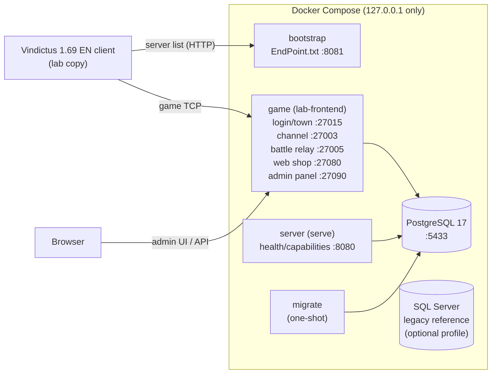

<div align="center">

# Vindictus Server — Rust Preservation Project

**A from-evidence rewrite of the legacy Vindictus (Mabinogi Heroes) .NET server in Rust, PostgreSQL and Docker.**


[What it is](#what-it-is) ·
[Status](#status-at-a-glance) ·
[Architecture](#architecture) ·
[Requirements](#requirements) ·
[Quick start](#quick-start) ·
[Admin panel](#admin-panel) ·
[Playing in the lab](#playing-in-the-lab) ·
[Development](#development-and-tests) ·
[Documentation](#documentation-map)

</div>

> [!TIP]
> ⭐ **If you like this project, please give it a star!** It helps other Vindictus fans and preservationists find it.
> 🤝 **Contributions are welcome:** bug reports, reverse-engineering findings, client test results, documentation and code. See [Contributing](#contributing).

> [!IMPORTANT]
> This is a research and preservation project for a laboratory environment. **The migration is not finished.** It does not ship any game client, game assets, original server binaries, database backups or decompiled sources, and you have to provide your own legitimately obtained copies. All services bind to `127.0.0.1` by default and are not hardened for public hosting.

## What it is

Vindictus is an action MMORPG whose original server was a set of Windows .NET services backed by SQL Server. This repository rebuilds that server as a single Rust application, using evidence recovered from the original program, so that the old **Vindictus 1.69 EN (2016)** client can connect to it and play.

### The problem it solves

- **Preservation.** The original services need an obsolete Windows/.NET/SQL Server stack and native components that can no longer be maintained. This project replaces them with a portable, containerized server.
- **Compatibility without guesswork.** Wire formats, rules and values are recovered from the original code and checked with differential tests (*oracles*) against the recovered C#. Nothing is "close enough": opcodes, data layouts and game values are never invented.
- **Maintainability.** The result is a modular Rust codebase with typed errors, bounded parsing, prepared SQL, Argon2id passwords and graceful shutdown, plus a web admin panel to operate the game.
- **Extensibility.** It is a base for studying new content, such as items, stages and new playable classes (Delia, class 10, is already playable in the lab).

## Status at a glance

The work is organized into blocks (see the [roadmap](docs/playable-game-roadmap.md)). The live status, what is left to do and the next action are always in **[MIGRATION.md](MIGRATION.md)**.

| Block | Scope | Code | Client acceptance |
|---|---|:---:|:---:|
| **B0** | Character in town: login, creation, selection, movement, inventory, equipment, quickslots, skills/AP | ✅ | ✅ |
| **B1** | Town: gold, NPCs and dialogs, shops (buy/sell/buyback/repair), stories and quests | ✅ | ⏳ |
| **B2** | Stages and combat: mission entry, ProudNet battle relay, dungeons, monsters, drops, rewards, disconnects | ✅ | ⏳ |
| **B3** | Gear progression: item attributes, Craft, Enhance, Enchant, storage, SkillEnhance, cash shop, VIP | ✅ | ⏳ |
| **B4** | Admin panel, password login, free names, all 10 original classes, extension feasibility report | ✅ | 🟡 partial |
| **B5** | Multiplayer (party, sync), PvP, guilds, trade, mail, auction, final parity | 🚧 in progress (pets done) | — |

✅ done · 🟡 partial · ⏳ waiting for the operator's client session · 🚧 in progress

Side tracks: new playable class **Delia** (accepted in the client; creation from the class grid works, with a few checks pending), item editor, stage editor and game launcher studies (see [`docs/future/`](docs/future)).

## Architecture

A **modular monolith**: one Rust binary with several subcommands, with layers that keep game rules, persistence and wire formats apart.



| Layer | Folder | Responsibility |
|---|---|---|
| Domain | `src/domain` | Types, invariants and recovered game rules |
| Application | `src/application` | Use cases, sessions and orchestration |
| Infrastructure | `src/infrastructure` | PostgreSQL persistence, game runtime and transports |
| Protocol | `src/protocol` | Packet framing, ISAAC cipher, recovered message codecs |
| HTTP | `src/http` | Operational endpoints and the admin panel API |
| Admin UI | `web/admin` | React + Vite single-page admin panel |
| Schema | `migrations` | Incremental PostgreSQL migrations |
| Tests | `tests` | Differential (oracle) tests, integration tests and fixtures |
| Tooling | `scripts` | Dev/verification, content export, client lab preparation, reverse engineering |

**Data.** PostgreSQL holds accounts and character state. The game content (items, NPCs, quests, stages) comes from the client's SQLite databases, exported into versioned JSON profiles that are kept apart from transactional state. SQL Server is used only as an untouched reference to compare against the legacy data.

More detail: [architecture](docs/architecture.md), [database decision](docs/database-decision.md), [protocol](docs/protocol.md), [battle transport](docs/battle-transport.md).

## Requirements

| Use | You need |
|---|---|
| Run the server stack | Docker Desktop (Linux containers) with Docker Compose, PowerShell 7.4+ |
| Develop and test | Rust **1.98.0** with rustfmt and Clippy (pinned by `rust-toolchain.toml`), Python 3.13 (`py -3.13` on Windows), Node.js 24 for the admin UI |
| Play in the lab | A legitimately obtained **Vindictus 1.69 EN** client (Windows) and the private content exported from it |
| Legacy comparison (optional) | The original SQL Server backups, the `legacy` Compose profile, .NET SDK and ILSpy for the oracle scripts |

Rust and Node are not needed only to run the Docker images: the build stages compile everything.

## Quick start

This starts the infrastructure (PostgreSQL, migrations and the operational HTTP service). Run it from the repository root:

```powershell
# First run only: creates .env with generated credentials (keep it if it already exists).
pwsh -File scripts/dev/init-env.ps1

# Build and start the server (applies migrations first).
docker compose up -d --build --wait server

# Check it is alive.
Invoke-RestMethod http://127.0.0.1:8080/health/ready
Invoke-RestMethod http://127.0.0.1:8080/capabilities
```

Create an account (the password is read without echo and passed to the CLI through stdin):

```powershell
pwsh -File scripts/dev/create-account.ps1 -Username researcher
```

Stop and restart while keeping the data:

```powershell
docker compose stop
docker compose up -d --wait server   # or without "server" once the lab inputs below exist
```

> [!WARNING]
> The database lives in Docker volumes. Never use `docker compose down -v`, which deletes them. A fresh clone starts with an empty database: migrations create the schema, they do not import any private data.

Ports, configurable in `.env`:

| Service | Address | Purpose |
|---|---|---|
| `server` | `127.0.0.1:8080` | Readiness and capabilities |
| `postgres` | `127.0.0.1:5433` | Rust server database |
| `bootstrap` | `127.0.0.1:8081` | `EndPoint.txt` server list for the client |
| `game` | `127.0.0.1:27015` / `27003` / `27005` | Login and town, channel, battle relay |
| `game` | `127.0.0.1:27080` | In-game web shop pages |
| `game` | `127.0.0.1:27090` | Admin panel (UI and API) |
| `legacy-sqlserver` | `127.0.0.1:14333` | Optional legacy reference (`--profile legacy`) |

## Admin panel

The web admin panel is how you create game accounts and manage the server day to day. It is served by the `game` service at **<http://127.0.0.1:27090>**, on loopback only, with its own login, role checks and an audit log of every change.

**First access.** Create an account and give it the `admin` role:

```powershell
pwsh -File scripts/dev/create-account.ps1 -Username myadmin
pwsh -File scripts/dev/account-set-role.ps1 -Username myadmin -Role admin
```

Roles: `admin` (everything), `gm` (game management) and `leitura` (read-only). `none` removes access. After that, accounts can be created and managed from the panel itself.

| Page | What you can do |
|---|---|
| **Accounts** | Create game accounts, reset passwords, assign panel roles |
| **Characters** | Inspect any character, give or remove items, gold and cash, set level and progression, arrange the inventory |
| **Item editor / Models** | Create, clone, edit or hide items, and manage 3D model kits for new gear |
| **Shops / Cash shop** | Edit NPC shop catalogs by location and NPC, and cash shop products and prices |
| **Tuning** | Change live game rates (EXP, gold, drops) and Enhance/Enchant chances without restarting |
| **Content** | Publish versioned content changes with scheduled maintenance; the lab launcher brings the client up to date |
| **World** | Maps and channels (read-only) |
| **Audit** | Who changed what, and when |

The panel never reimplements the game login. Game accounts log in through the client with the account name. Plan and extension points: [docs/b4-painel-plano.md](docs/b4-painel-plano.md).

## Playing in the lab

The `game` service needs private inputs that are never committed: a prepared client copy, content exported from that client and a protected runtime profile. The outline:

1. **Client copy.** Copy your 1.69 EN client to `.cache/play-client`. Originals stay read-only.
2. **Point the client at the lab** with `scripts/client/prepare_lab_client.py` (dry run first, then `--apply`), which rewrites the server list in the copy and creates a backup. See [client compatibility](docs/client-compatibility.md).
3. **Export the content** with `scripts/content/export_*.py` into `.cache/private-content` (commands in [content tuning](docs/content-tuning.md) and in the "Preparation" section of each test script).
4. **Prepare the runtime profile** with `scripts/dev/prepare-lab-frontend-profile.ps1`, which is mounted as a Docker secret.
5. **Build and start everything:**

   ```powershell
   $env:COMPOSE_PARALLEL_LIMIT = 1
   docker compose build
   docker compose up -d --wait
   docker compose ps   # game and server should be healthy
   ```

6. **Create your account** in the [admin panel](#admin-panel).
7. **Play** through `.cache/play-client/start-lab.bat`. Log in with the account name.

Lab helpers: `scripts/dev/lab-give-item.ps1`, `lab-give-cash.ps1`, `lab-set-class.ps1` and `account-set-role.ps1`. Every client test script in [`docs/client-tests/`](docs/client-tests) starts with an up-to-date preparation checklist.

## Development and tests

```powershell
# Fast gate: format, Clippy (-D warnings), Rust tests, doctests, build, Python tests.
pwsh -File scripts/dev/verify.ps1

# Full gate, including PostgreSQL integration tests in isolated schemas.
$env:TEST_DATABASE_URL = (Get-Content .cache/database-url -Raw).Trim()
try { pwsh -File scripts/dev/verify.ps1 -DatabaseIntegration } finally { Remove-Item Env:TEST_DATABASE_URL }

# Docker smoke: migrate, readiness, account creation, duplicate rejection, restart persistence.
pwsh -File scripts/dev/smoke-docker.ps1
```

- Within a block, run only the focused tests for what changed (`cargo test --test <target>`, filtered PostgreSQL tests). The full gate runs when a block closes.
- Cargo is capped at 4 jobs and 4 test threads (`.cargo/config.toml`), and Docker builds use `COMPOSE_PARALLEL_LIMIT=1`.
- Full logs go to `.cache/verification/`. Results of the last gate: [verification report](docs/evidence/verification/REPORT.md).
- When a recovered wire format changes, regenerate its fixtures with the `scripts/reverse/generate-*-fixtures.ps1` oracles.

### Ground rules

- Never invent opcodes, values or behavior: recover them from evidence and test them against the recovered reference.
- Never send a fake success to the client: unported features are refused explicitly.
- No `unsafe`, no `unwrap`/`expect` in production code, no secrets in logs, arguments or source.
- Originals (clients, backups, legacy server, reference clients) are read-only evidence.

The full contributor and agent rules are in [AGENTS.md](AGENTS.md).

## Documentation map

> Project documents are written in Portuguese (pt-BR); code and commit messages are in English.

| I want to know… | Read |
|---|---|
| **What is done, what is left and the next action** | [MIGRATION.md](MIGRATION.md) — the live roadmap and checklist |
| The work order and how blocks are run | [docs/playable-game-roadmap.md](docs/playable-game-roadmap.md) |
| What to test in the game client, step by step | [docs/client-tests/](docs/client-tests) — one script per block (B1–B5, C2, C3) |
| The detailed history of every session and its evidence | [docs/history/session-log.md](docs/history/session-log.md) — append-only and large: search it by step id instead of reading it whole |
| How the system is designed | [docs/architecture.md](docs/architecture.md), [docs/protocol.md](docs/protocol.md), [docs/database-decision.md](docs/database-decision.md) |
| Which client to use and how to prepare it | [docs/client-compatibility.md](docs/client-compatibility.md) |
| Where the tunable game values live | [docs/content-tuning.md](docs/content-tuning.md) |
| The admin panel plan and extension points | [docs/b4-painel-plano.md](docs/b4-painel-plano.md), [docs/extension-feasibility.md](docs/extension-feasibility.md) |
| How to port a new playable class | [docs/new-class-guide.md](docs/new-class-guide.md), [docs/future/delia-class-port.md](docs/future/delia-class-port.md), [`.agents/skills/new-class-port`](.agents/skills/new-class-port/SKILL.md) |
| Future features (item editor, launcher, stage editor, pets) | [docs/future/](docs/future) |
| Contracts of individual subsystems | The topic files in [docs/](docs) (login, characters, items, skills, mail, …) |
| Git, verification and skills used by the project | [docs/git-workflow.md](docs/git-workflow.md), [docs/verification.md](docs/verification.md), [docs/skills.md](docs/skills.md) |

## Contributing

Contributions of every size are welcome. Good ways to help:

- **Play-test** an entry from [`docs/client-tests/`](docs/client-tests) and report what happened (entry id, what you did, what appeared on screen, time).
- **Recover evidence**: a message format, a game rule or a client behavior, with the source it came from.
- **Port a pending feature** from the lists in [MIGRATION.md](MIGRATION.md), with focused tests.
- **Improve the docs**, including English translations.

Before opening a pull request, read [AGENTS.md](AGENTS.md) (architecture, safety and verification rules), keep each change small and verified, and never include game assets, client files, backups, credentials or decompiled sources.

## Legacy reference and reverse engineering

The Rust server does not depend on SQL Server. To restore and compare the legacy data, keep your legitimately obtained files **outside** this repository in this layout:

```text
VindictusPrivate/
├── vindictus-server/      # this repository
├── ServidorVindictus/     # original server (read-only)
│   └── database/          # .bak backups
├── Client/                # original client (read-only)
└── Vindictus1.69EN/       # reference client copy (read-only)
```

```powershell
docker compose --profile legacy up -d --wait legacy-sqlserver
pwsh -File scripts/database/Restore-Legacy.ps1 -BackupName heroes.bak -DatabaseName study_heroes
```

Decompiled output, raw SQL catalogs, private exports and game assets are ignored by Git. Only sanitized evidence (hashes, counts, metadata and synthetic fixtures) is committed.

## License and disclaimer

No license is granted for the game, its client, its assets or its original server, which belong to their respective owners. This repository contains only original Rust/Python/PowerShell/TypeScript code and sanitized evidence produced for interoperability and preservation research. It is not affiliated with or endorsed by Nexon or devCAT.
